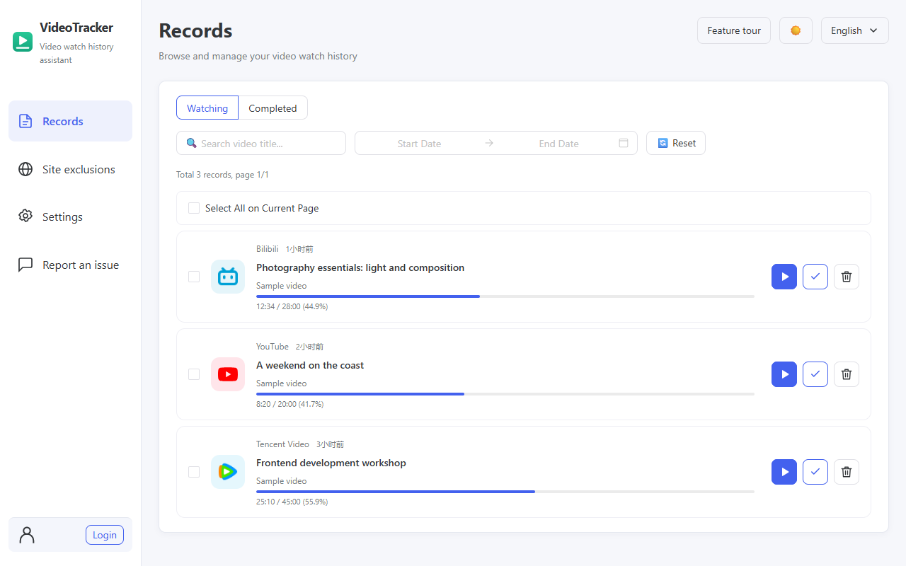
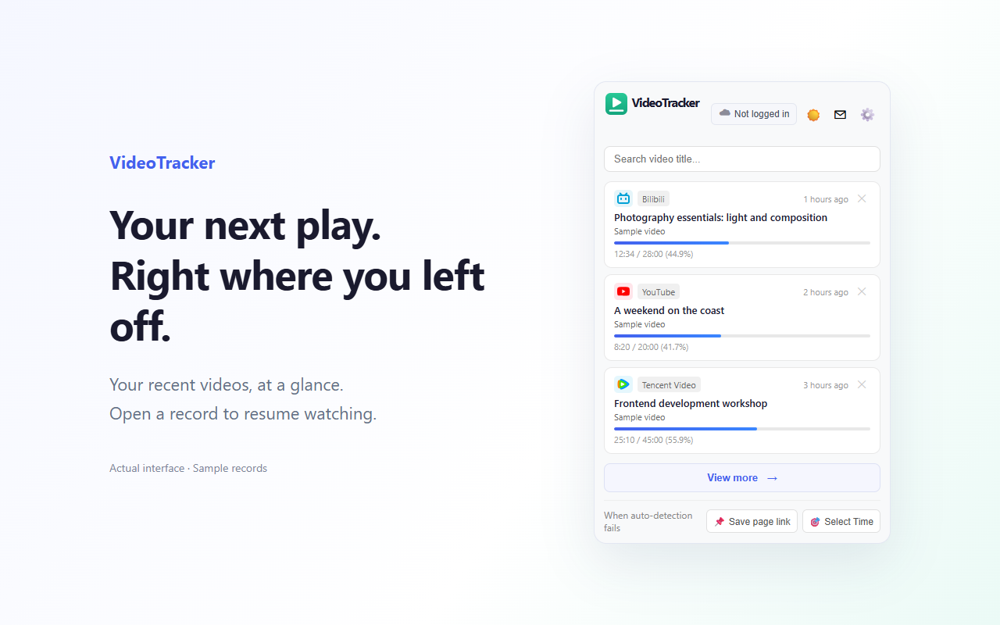
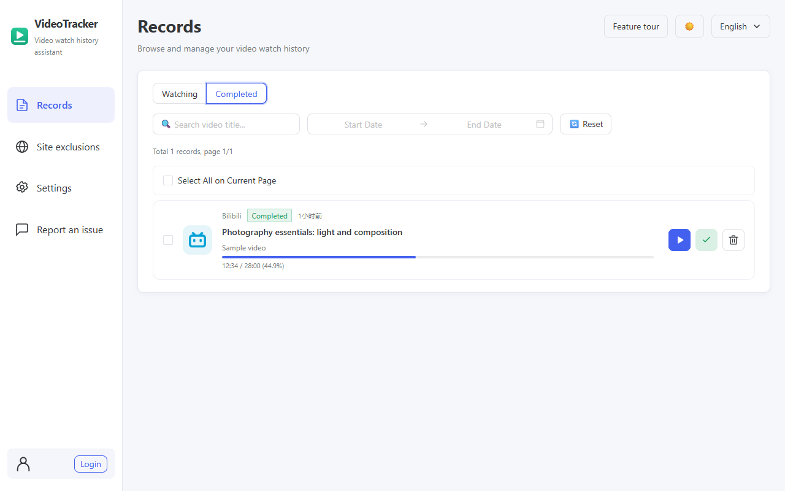

# VideoTracker

[简体中文](README.md)

Latest published version: `0.0.14`, released on 2026-10-20. [Download the latest Chrome / Edge package](https://github.com/Ankkaya/video-tracker/releases/download/v0.0.14/video-tracker-0.0.14-chrome-mv3.zip) · [Release notes and checksum files](https://github.com/Ankkaya/video-tracker/releases/tag/v0.0.14).

[Website](https://video-tracker.ankkaya.top/en/) · [Privacy policy](https://video-tracker.ankkaya.top/privacy-policy.html) · [Support](https://github.com/Ankkaya/video-tracker/issues)

VideoTracker saves video watch progress across Bilibili, YouTube, iQIYI, Tencent Video and other compatible HTML5 video sites. Open a saved record to resume in a supported player. Local recording works without an account; cross-device encrypted sync is optional.

The descriptions and screenshots below reflect version 0.0.14 (2026-10-20).

## Features

- Automatic recording is off by default. Enable it and choose a threshold of 0, 10, 30, 60 or 120 seconds; the default threshold is 30 seconds.
- Save manually with `Ctrl+Shift+V`, or `Command+Shift+V` on Mac. Manual saving works even when automatic recording is off or a site is excluded. Browser shortcut settings can resolve unassigned or conflicting shortcuts.
- The popup focuses on unfinished videos. Switch between Watching and Completed on the records page, mark completion manually without losing position, or watch completed videos again from the beginning.
- Search titles in the popup; filter records by title, episode and viewing date, with individual or batch deletion and site icons.
- Existing records keep tracking progress even with automatic recording off or the site excluded. Pause, end and video switches trigger saves; only actual playback counts toward the threshold for new records.
- A four-step first-use tour introduces records, automatic recording, the viewing threshold and shortcuts. Skip, resume or restart it at any time.
- Add a domain or HTTP/HTTPS webpage URL to the site exclusion list to stop automatically adding new records for its domain and subdomains. Remove it to restore recording when the global switch is on. Existing records stay and continue tracking progress.
- Choose Chinese or English and a light, dark or system theme.
- Sign in and set a separate sync encryption password for optional end-to-end encrypted sync of records, site rules and deletion markers. The sync password is not uploaded.
- Open the feedback page from the popup or options. Send up to 500 characters, one optional PNG/JPG/WebP image up to 5 MB and an optional email. No sign-in is required. A signed-in email is prefilled but editable or removable. The first submission requires confirming the purpose; failures keep your draft, and success shows a short message.

Detection and playback restoration depend on the website and player. Live streams, restricted players and some third-party sites may need manual recording or may not support restoration.

## Interface preview







Actual interface with fictional sample records.

## Install or build

For a published version, download its Chrome MV3 ZIP from Releases, extract it, enable developer mode on your browser's extensions page and load the extracted directory.

To use the latest source:

```bash
npm install
npm run build
```

Load `.output/chrome-mv3/` in Chrome or Edge. `npm run dev` starts development with hot reload. `npm test` runs the automated tests.

## First use

The records page opens on first installation with a four-step tour of records, automatic recording, minimum watch time and the manual-save shortcut. Next navigates to each page and highlights the relevant controls, which remain usable. Go back, skip, or restart from “Feature tour” in the page header. An unfinished tour resumes its saved step; completed or skipped tours do not reopen automatically.

Finishing the tour returns to records. Enable automatic recording, open a video and play it for the minimum watch time. Use the manual-record shortcut assigned by your browser to save playback progress immediately. Choose “Continue watching” on a record to resume in a supported player.

No account is needed. The feature tour remembers completion on this device, and updates do not reopen it. Existing users with records skip the tour. The records page and extension popup use simple empty-list messages, without additional first-save walkthrough cards. Searches with no results offer a way to clear filters. Refresh video pages that were open before installation. “Save page link” saves a link, not video progress.

## Progress tracking and completion

Existing records keep tracking even when automatic recording is off or the site is excluded from adding new records. Playback progress is read every 5 seconds and saved every 30 seconds, with immediate saves on pause, end and video switches. Only actual playback counts toward the threshold for adding a new video; paused, buffering and seek time do not count.

The popup shows unfinished videos. The records page offers Watching / Completed filters and manual completion controls that preserve the playback position. Ending playback marks a video completed; reaching 98% with at most 10 seconds remaining also qualifies. Watch again opens from the beginning. Starting playback earlier returns the record to Watching.

Matching uses platform video IDs and part/episode IDs. Generic sites use canonical page URLs and media sources, with title/duration as a fallback. Existing records remain compatible. Resume links verify the matching saved record before seeking; players without reliable content identity may need site-specific support.

## Data and privacy

Viewing records are stored locally by default. Sign-in sends account information to the authentication service. Optional sync encrypts records on the device before upload to the configured Supabase service; the device remembers a sync data key locally. Remote thumbnails can make image requests even with sync off. No advertising trackers or analytics are used, and data is not sold.

Confirmed feedback sends the entered text, image and email over HTTPS to the developer-configured Supabase service for the developer to read, investigate and reply. Images are private. Feedback is separate from end-to-end encrypted record sync, with no automatic attached watch history, credentials or tokens and no automatic GitHub publication. GitHub Issues is also available from the feedback page.

Signing out preserves local records but clears session and sync unlock state. Uninstalling does not delete cloud data. If you forget your sync password, cloud reset replaces the old cloud snapshot using newly encrypted data from your device; cloud-only old data cannot be recovered. Other devices need the new password. Contact the developer to request deletion of cloud/account data or feedback; provide submission time, content or email to help locate feedback, and avoid posting private information in public issues. See the full [privacy policy](PRIVACY_POLICY.md).

## Backend and publishing materials

Encrypted sync setup: `docs/supabase-setup.sql`, followed by `docs/supabase-reset-encrypted-sync.sql`. Feedback setup uses `docs/supabase-feedback.sql`, the private `feedback-images` bucket and the `submit-feedback` Edge Function. See [feedback deployment notes](docs/FEEDBACK.md). Server secrets stay on the server.

The bilingual website is in `landing/`. Chrome and Edge descriptions, release notes, screenshots, privacy references and reviewer instructions are in [Chrome materials](output/chrome-store/README.md), [Edge materials](output/edge-store/README.md) and [shared listing copy](docs/STORE_LISTING.md). These describe the current source; build a matching package before uploading.

`npm run generate:store` regenerates both stores' localized copy from the shared document. `npm run generate:privacy` updates the packaged and website privacy pages. Screenshots use real Vue components and fictional data, without a real account or feedback submission.

## License

MIT
