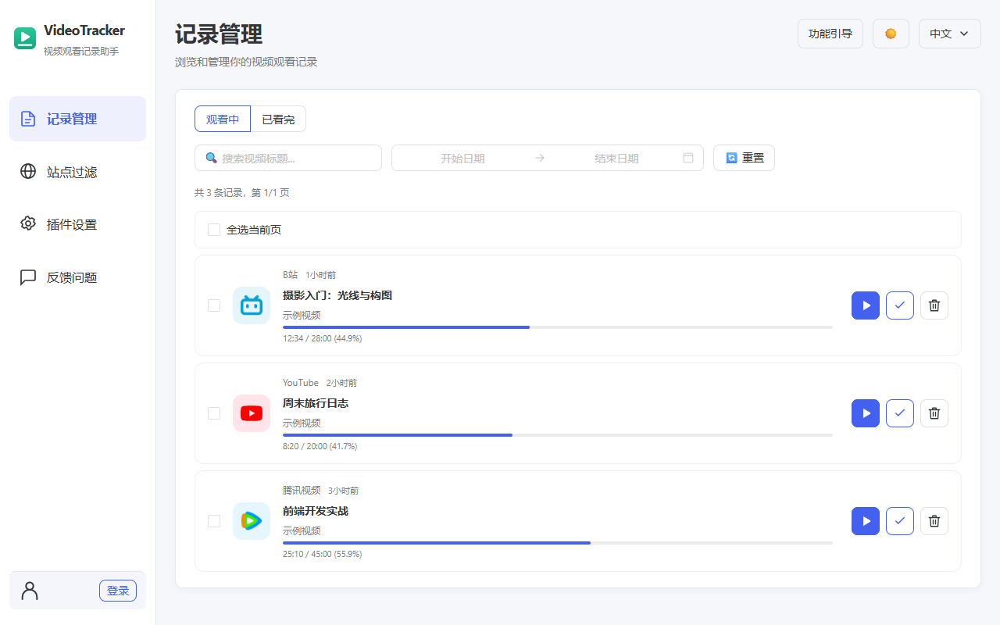
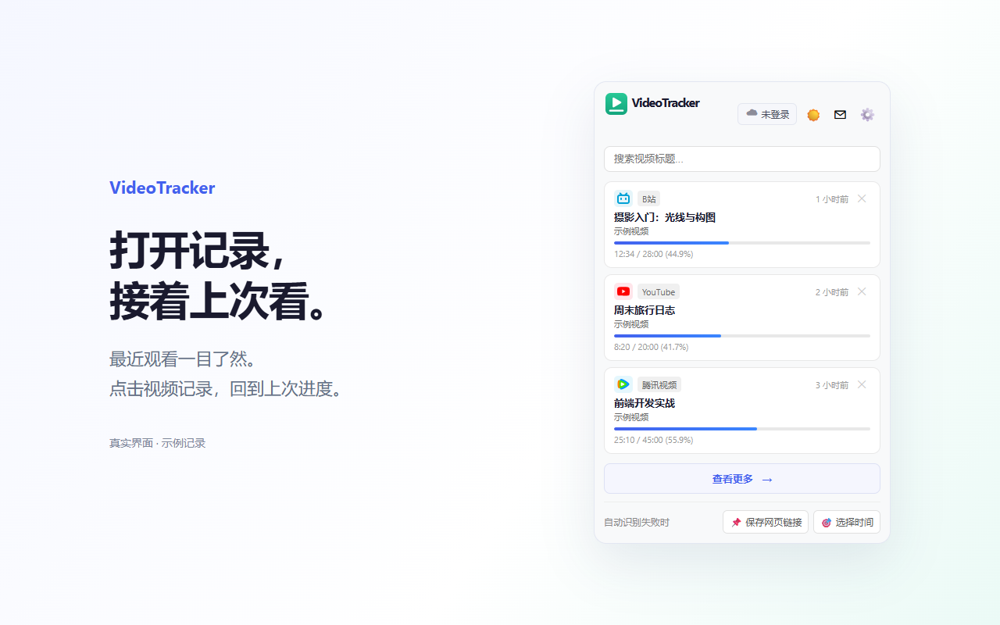
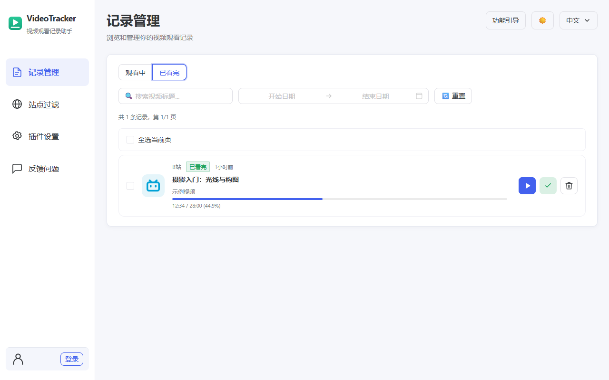

# VideoTracker - 视频观看进度记录器

[English](README.en.md)

最近发布版本：`0.0.14`（发布于 2026-10-20）。[下载最新版 Chrome / Edge 安装包](https://github.com/Ankkaya/video-tracker/releases/download/v0.0.14/video-tracker-0.0.14-chrome-mv3.zip) · [更新说明与校验文件](https://github.com/Ankkaya/video-tracker/releases/tag/v0.0.14)。

[官方网站](https://video-tracker.ankkaya.top/) · [English website](https://video-tracker.ankkaya.top/en/) · [隐私政策](https://video-tracker.ankkaya.top/privacy-policy.html) · [问题反馈](https://github.com/Ankkaya/video-tracker/issues)

保存 B站、YouTube、爱奇艺、腾讯视频及其他兼容 HTML5 视频网站的观看进度，下次接着看。用“观看中 / 已看完”整理记录，也可从头重新观看。本地记录无需账号，可选端到端加密云同步。

以下介绍与截图对应 0.0.14（2026-10-20）。

## 功能特性

- **自动记录与持续跟踪** — 自动记录默认关闭；开启后按实际播放时长新增记录，支持 0 / 10 / 30 / 60 / 120 秒阈值，默认 30 秒。已有记录持续更新，暂停、播放结束或切换视频时及时保存。
- **快捷键保存** — 使用浏览器分配的手动记录快捷键立即保存；默认建议为 Ctrl+Shift+V（Mac：Command+Shift+V），可在扩展快捷键设置中调整。
- **接着看或重新看** — 从弹窗继续未看完的视频，在支持的播放器中恢复进度；已看完的视频可从头重新观看。
- **观看状态管理** — 记录页分为“观看中 / 已看完”，支持自动判断完成，也可手动标记状态，保留播放位置。
- **查找与整理** — 弹窗按标题搜索；记录页按标题、分集和日期筛选，支持单条或批量删除，显示站点图标。
- **站点排除** — 输入域名或网页链接，停止该域名及子域名自动新增记录；已有记录继续跟踪，手动保存仍可使用。
- **可选加密同步** — 本地记录无需账号；登录后设置独立同步密码，同步观看记录、站点规则及删除标记。
- **首次使用引导** — 四步了解记录、自动记录、最低观看时长与快捷键，可跳过、继续或重新查看。
- **问题反馈** — 无需登录即可发送最多 500 字、一张不超过 5 MB 的 PNG/JPG/WebP 图片及可选邮箱，首次提交前确认用途。
- **中英文与主题** — 支持中文、英文及浅色、深色、跟随系统主题。

### 界面预览







截图来自当前真实界面，使用虚构示例记录。

## 安装方法

### 从 Release 安装

1. 打开 [GitHub Releases](https://github.com/Ankkaya/video-tracker/releases)
2. 下载对应已发布版本的 `video-tracker-<版本>-chrome-mv3.zip`（已发布版本可能早于当前源码）
3. 解压 zip，得到 Chrome MV3 扩展目录
4. 打开 Chrome 或 Edge，访问 `chrome://extensions/`
5. 开启右上角的 **开发者模式**
6. 点击 **加载已解压的扩展程序**
7. 选择解压后的目录

### 从源码构建

```bash
npm install
npm run build
```

构建产物位于 `.output/chrome-mv3/`，可直接在浏览器开发者模式中加载。

## 使用说明

### 第一次使用

首次安装会打开记录管理页，并用步骤提示框依次介绍记录管理、自动记录开关、最低观看时长和手动记录快捷键。“下一步”会切换到对应页面并高亮功能区域，可以直接操作高亮的设置；支持上一步、跳过和从页面顶部“功能引导”重新查看。未完成时再次打开记录管理页会接着上次的步骤，完成或跳过后不再自动展示。

完成步骤引导后返回记录管理页。开启自动记录，打开视频并播放，达到最低观看时长后即可看到记录；也可在视频页使用浏览器实际分配的手动记录快捷键立即保存播放进度。点击记录上的“继续观看”可在支持的播放器中恢复到保存位置。

本地记录无需登录。步骤提示框会记住完成状态，更新扩展不会重复打开；已有记录的用户不重复展示首次引导。记录管理页和插件弹窗仅显示简洁的空列表提示，不再展示额外的首次保存引导卡片。搜索或筛选无结果时可清除条件。若视频页在安装前已打开，请刷新后再保存。“保存网页链接”只保存链接，不代替视频进度记录。

### 自动记录

自动记录默认关闭。在设置中开启后，VideoTracker 会记录你访问的视频页面：

1. 打开 B站、YouTube、爱奇艺或腾讯视频的任意视频播放页
2. 开始观看视频
3. 观看时间达到阈值（默认 30 秒）后，视频信息和播放进度会自动记录
4. 记录包括：视频标题、平台、封面、当前播放时间、记录时间

### 进度跟踪与已看完

已有记录会独立跟踪进度，不受自动记录开关和站点新增排除规则影响。播放时每 5 秒读取一次，每 30 秒保存一次；暂停、结束、切换视频时立即保存。自动记录开关仅决定未保存的视频能否在达到阈值后自动新增，暂停、缓冲和拖动进度条不累计为实际观看时长。

插件首页只显示未看完的视频。记录页可切换“观看中 / 已看完”，并手动标记已看完或未看完，标记操作保留原播放进度。播放结束会自动标记已看完；进度达到 98% 且剩余不超过 10 秒时也会判断为已看完。“重新观看”从头打开，开始从较早位置播放后恢复为观看中。

视频身份按平台视频 ID、分P或单集信息统一匹配；通用网站结合规范化页面地址和视频来源，缺少稳定来源时以标题和时长辅助识别。旧记录会在匹配和更新时兼容处理。恢复进度前会校验打开的视频是否匹配记录；无法可靠识别内容的播放器仍可能需要专门适配。

### 手动记录

如果你想立即记录当前视频，无需等待阈值：

- 按快捷键 `Ctrl+Shift+V`（Mac: `Cmd+Shift+V`）
- 当前视频会立即被记录，包括标题、进度等信息

### 查看记录与继续观看

1. 点击浏览器工具栏中的 VideoTracker 图标
2. 弹出窗口中显示未看完的视频列表；已看完的视频可在完整记录页查看
3. 列表按最近观看时间排序，最新的在最上面
4. 点击任意记录即可打开视频页面，并定位到上次播放位置

### 搜索筛选

在 Popup 顶部的搜索栏中：

- **关键词搜索** — 输入视频标题关键词，实时过滤记录
- **观看日期** — 在完整记录管理页按日期范围筛选，可选今天或最近 7、30、90 天

### 站点过滤

在选项页打开“站点过滤”，输入域名或 HTTP/HTTPS 网页链接，加入排除名单。规则覆盖该域名及所有子域名，停止自动新增记录；已有记录保留并继续更新进度。移出名单后，该站点恢复参与自动记录；全局自动记录仍需开启。手动保存不受排除名单影响。其他兼容 HTML5 视频网站默认尝试识别，无需先添加。

### 加密云同步

VideoTracker 的同步功能是可选的，并且采用端到端加密设计：

1. 在 Popup 或选项页登录账号
2. 开启云端同步时，首次使用需要设置同步加密密码并确认两次
3. 之后当前设备会记住本地 Data Key，重启浏览器后通常不需要再次输入同步密码
4. 换设备、退出登录、卸载浏览器或清除本地数据后，需要重新输入同步密码解锁
5. 点击“立即同步”会合并本地和云端的观看记录、站点规则，并上传加密后的数据

同步密码只用于解锁加密密钥，不会上传。忘记密码时，在设置页点击“忘记同步密码？重置云端数据”，输入并确认新密码后重置。当前设备的本地记录和站点规则会保留，并使用新密钥重新上传；仅存在于云端的旧数据无法恢复，无需先备份本地数据。其他设备需要更新插件，并使用新密码重新解锁同步。

### 设置

点击 Popup 中的设置图标或右键扩展图标选择“选项”：

- **自动记录开关** — 开启/关闭自动记录功能
- **阈值设置** — 设置自动记录的观看时长阈值：
  - `0 秒` — 开启自动记录后立即保存
  - `10 秒` — 观看 10 秒后自动记录
  - `30 秒` — 观看 30 秒后自动记录（默认）
  - `60 秒` — 观看 1 分钟后自动记录
  - `120 秒` — 观看 2 分钟后自动记录
- **云端同步** — 登录后开启加密同步，自动同步打开后每次记录变更会触发同步
- **快捷键说明** — 显示当前可用的快捷键

### 反馈问题

点击弹窗反馈按钮或选项页的“反馈问题”。文字最多 500 字，可附一张 PNG/JPG/WebP 图片（不超过 5 MB）。邮箱可以留空；登录后默认带出账号邮箱，允许修改或清空。首次提交时说明反馈会通过 Supabase 发送给开发者，供排查和回复；确认弹窗可查看完整隐私政策。取消不发送，失败保留内容，成功显示简短提示。也可以通过页面底部的 GitHub Issues 反馈。

服务端部署与处理方式见 [反馈功能](docs/FEEDBACK.md)。反馈与观看记录加密同步独立，关闭同步仍可主动提交反馈。

## 支持的平台

| 平台 | 网址 | 说明 |
|------|------|------|
| B站 | bilibili.com | 支持番剧、视频、电影等 |
| YouTube | youtube.com | 支持普通视频、Shorts 等 |
| 爱奇艺 | iqiyi.com | 支持电影、电视剧、综艺等 |
| 腾讯视频 | v.qq.com | 支持电影、电视剧、综艺等 |
| 通用识别 | 任意兼容 HTML5 视频网站 | 默认自动识别，可按站点关闭自动记录 |

## 快捷键说明

| 快捷键 | 功能 |
|--------|------|
| `Ctrl+Shift+V` | 立即记录当前视频（Mac: `Cmd+Shift+V`） |

> 快捷键可在 `chrome://extensions/shortcuts` 中自定义修改。

## 隐私说明

VideoTracker 高度重视你的隐私：

- **默认本地存储** — 观看记录默认存储在浏览器本地（`chrome.storage.local`），本地记录无需账号
- **同步需主动开启** — 只有登录并开启云端同步后，加密密文才会发送到配置的 Supabase 项目
- **端到端加密** — 观看记录和站点规则在上传前已经加密，云端只保存密文
- **不保存同步密码** — 同步密码不上传；当前设备仅保存可用于解锁的本地 Data Key
- **数据用途透明** — 登录时认证服务处理账号和会话信息；可选同步上传加密数据，远程封面加载会产生网络请求。不使用广告追踪或分析服务，不出售数据。
- **主动反馈** — 确认后发送填写的文字、图片及邮箱，供开发者阅读处理；图片私有存储。反馈独立于加密同步，不自动附带观看记录、密码或令牌。
- **权限最小化** — 仅请求必要的浏览器权限，不获取多余权限
- **可控删除** — 可删除本地记录；退出登录会清除本地同步解锁状态。卸载不会自动删除云端数据，云端或账号删除可联系开发者申请。

如果不使用云端同步，你的观看记录只存在于当前浏览器本地。

## Supabase 数据表

部署时先执行 `docs/supabase-setup.sql`，再在 Supabase SQL Editor 中执行 `docs/supabase-reset-encrypted-sync.sql`（已有项目只需执行后者）。重置脚本可重复执行，提供密钥与数据的原子替换，并阻止旧密钥覆盖重置后的云端数据；未安装该脚本时，重置功能无法使用。

加密云同步只需要两张表：

- `user_encryption_keys` — 保存每个用户的加密密钥元数据、盐值、KDF 参数和被同步密码保护的 Data Key 密文
- `encrypted_sync_blobs` — 保存每个用户的加密同步数据包，包含观看记录和站点规则的密文

旧版明文同步表 `records`、`custom_sites` 已在 `0.0.5` 中移除，不再被插件读取或写入。

反馈功能另使用 `feedback_submissions`、`feedback_rate_limits`、私有 `feedback-images` 存储桶及 `submit-feedback` Edge Function。部署说明见 [docs/FEEDBACK.md](docs/FEEDBACK.md)，服务密钥只用于服务端。

## 技术栈

- **框架**: [WXT](https://wxt.dev/) — 下一代浏览器扩展开发框架
- **前端**: [Vue 3](https://vuejs.org/) + [TypeScript](https://www.typescriptlang.org/)
- **状态管理**: Vue 3 Composition API
- **存储**: Chrome Storage API (`chrome.storage.local`)
- **云同步**: Supabase Auth + Database + WebCrypto 加密
- **构建工具**: Vite（WXT 内置）

## 开发指南

### 环境要求

- Node.js >= 18
- npm 或 pnpm

### 安装依赖

```bash
npm install
```

### 开发模式

```bash
npm run dev
```

启动后会自动打开 Chrome 并加载扩展，修改代码后自动热更新。

### 构建

```bash
npm run build
```

构建产物位于 `.output/chrome-mv3/`，可直接在 Chrome 中加载。

### 测试

```bash
npm test
```


站点自动记录规则随加密同步保存。新同步包使用 v2 格式，不读取旧格式；已有旧云端包可通过设置页的云端重置入口重新上传当前设备数据。部署云端重置功能时需使用更新后的 `docs/supabase-reset-encrypted-sync.sql`。

## 官网与商店资料

官网中英文页面位于 `landing/`；Chrome 和 Edge 的中英文详情、更新说明、截图、隐私表单与审核步骤位于 [output/chrome-store](output/chrome-store/README.md)、[output/edge-store](output/edge-store/README.md) 和 [docs/STORE_LISTING.md](docs/STORE_LISTING.md)。这些资料描述当前源码，上传前须构建包含对应功能的安装包。

`npm run generate:store` 从统一商店文案生成两店资料与预览；`npm run generate:privacy` 从完整隐私政策生成官网和扩展内政策页面。截图使用当前 Vue 界面及虚构数据，不连接真实账号或发送反馈。

## 许可证

MIT License
